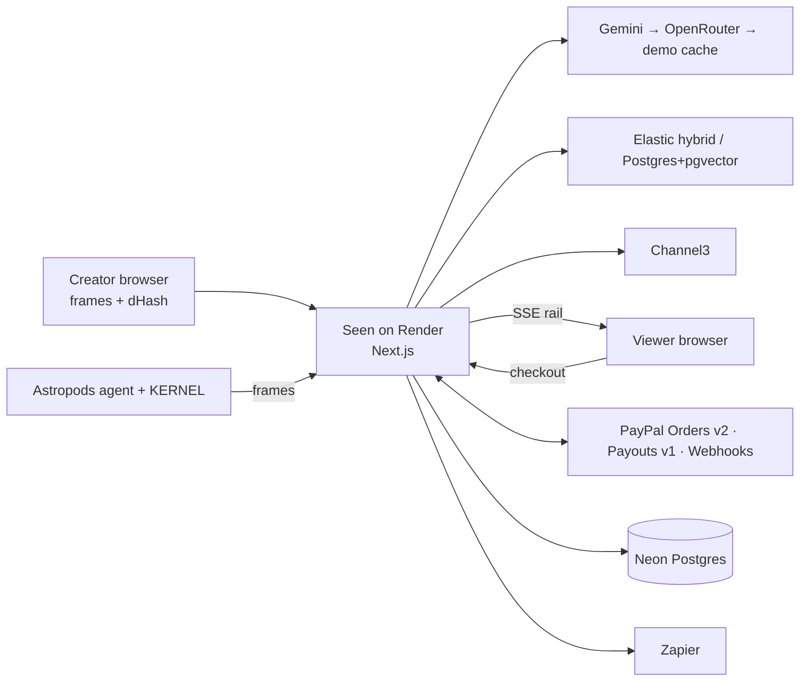

# Seen

> **If it's on screen, it's shoppable, and the creator gets paid.**

Seen is an AI that watches a creator's video or live stream and recognizes the products on screen. It pins one-tap **PayPal** buy buttons next to the video, and it pays the creator a commission through **PayPal Payouts**.

**Live demo:** _coming soon (Render)_ · **Video:** _coming soon (YouTube)_ · Built for PayPal's **Build What's Next with PayPal and AI** hackathon.

<!-- Hero GIF: docs/hero.gif (products popping onto the rail beside the video) -->

> The live demo runs on Render's free tier and sleeps when idle. If the first load is slow, give it about 60 seconds; after that it's fast.

## The problem

Live and video shopping is huge in Asia and growing fast everywhere else. Outside closed apps like TikTok Shop, though, it still runs on manual product tags, affiliate links and "link in bio". By the time a viewer finds the link, the impulse is gone. Creators who do earn affiliate money wait weeks for it, spread across networks with no clear view of what sold.

## How it works

1. **Seen watches.** Frames from the creator's video, screen share or own public stream URL go to a vision model, which returns the products in view as structured JSON.
2. **Seen matches.** Each stable detection is matched to a partner store's catalog. Exact matches get a **Buy with PayPal** card. Look-alikes from the open web show as "similar items", with a price comparison.
3. **Viewers buy, creators get paid.** Checkout opens in a drawer while the video keeps playing (PayPal or guest card). The sale is attributed to the exact moment and creator, a commission is recorded, and **Pay me now** sends it out with PayPal Payouts.

```
Video ─► frame sampler ─► dHash change filter ─► vision AI ─► tracker ─► product match ─► live rail (SSE)
                                                                                              │
          PayPal Payout ◄── commission ledger ◄── PayPal capture ◄── PayPal checkout ◄────────┘
```

**Why PayPal is the backbone:**
- **Checkout** turns every video into a new checkout moment, with buyer trust, guest cards and global reach.
- **Payouts** pays creators in many countries from one API call, in minutes instead of weeks.

Seen is the AI glue between the two.

## Try it in 3 minutes

No signup. You play both sides, in this order. A bar at the top of every page says who you are and what's next.

1. **Shop as a viewer.** Click **Start the demo as a viewer**.
   - You're watching creator **Maya Makes** (live, or a shoppable replay of her last stream).
   - Tap a product → **Buy now** → pay with a sandbox PayPal account, or choose **Debit or Credit Card** and use a test card from PayPal's [sandbox card generator](https://developer.paypal.com/tools/sandbox/card-testing/).
   - **No real money moves.** This is PayPal's sandbox, and no credentials are committed to this repo.
2. **See Maya get paid.** After paying, click **See Maya Makes's side →**. You're now Maya, in her studio. Your sale and her 10% commission are at the top of **Earnings**. Click **Pay me now** to send it to her PayPal with PayPal Payouts.
3. **Go live as Maya.**
   - **Go live** → **Share screen / OBS** → tick consent → **Go live**, then share a tab showing a hoodie, a mug or a desk lamp.
   - The AI spots the products, and they appear on the viewer page.
   - Try **Ask Seen**: "How much did I earn this week?"

## Features

- Product detection on any video: no platform APIs needed, since the AI watches pixels.
- Stable detections: 2 sightings within 15 s, embedding dedupe, no flicker. The creator can **pin**, **hide** or **correct** any item live.
- A live product rail pushed to viewers over Server-Sent Events, with a "Shop this moment" timeline for replays.
- **Live video to viewers, for $0:** the creator's browser streams straight to each viewer with WebRTC, so there's no media server to pay for. If a direct connection isn't possible, viewers see a live frame preview instead.
- PayPal checkout (JS SDK v6) in a drawer: PayPal button and guest card.
- A product page for every item: seller, details, PayPal trust lines and **Buy now** (still credits the creator). Plus real "also sold online" store links from Channel3, clearly marked as leaving Seen.
- Attribution from the exact on-screen moment to the order, the commission and the creator.
- Commission ledger with a hold window, refunds and reversals, and **Pay me now** via PayPal Payouts with live status.
- Verified, idempotent PayPal webhooks and a full audit timeline for every money event.
- Creator assistant: Gemini with tools plus the PayPal Agent Toolkit for read-only lookups. It still answers common questions when the AI is out of quota.
- Shareable AI stream recap page.
- Zapier events (sale, payout, recap) with an in-app notification center as the fallback.
- A "Watch my stream URL" source: a KERNEL cloud browser, optionally driven by an Astropods agent.
- A free-tier guard: quotas, saver mode and a demo cache. The demo works with zero AI quota.
- Mobile-first viewer that works at 375 px.

## Architecture

Full diagrams and the code map are in **[docs/ARCHITECTURE.md](docs/ARCHITECTURE.md)**.



### Lifecycle of one sale

1. **Frame.** The creator's browser samples the video. It sends a JPEG only when the dHash says the picture changed.
2. **Detection.** Gemini returns items through a strict JSON schema, which is validated with zod. Guardrails then:
   - drop people and denylisted categories;
   - ignore any text in the frame that tries to give instructions.
   The tracker makes a detection visible after 2 hits.
3. **Match.** Embeddings and text search find the partner product, scored "Exact" or "Similar". Channel3 adds similar items and a price comparison.
4. **Order.** The viewer's click records an attribution. The server builds the PayPal order **from the database** (price, currency, items) with a `PayPal-Request-Id`.
5. **Capture.** The browser captures. The webhook for the same capture is verified, deduplicated and ends up a `noop`, because both paths run through one state machine.
6. **Commission.** The commission is the creator's rate × the captured item total, in integer minor units. It goes PENDING, then ELIGIBLE after the hold window. A refund moves it to REVERSED.
7. **Payout.** **Pay me now** sends a PayPal Payouts batch (`sender_batch_id` = idempotency key). Status is tracked by polling and webhooks until the commission is PAID.

## Built with

| Tool | What it does in Seen | Where |
|---|---|---|
| **PayPal Orders v2 + JS SDK v6** | Viewer checkout (PayPal + guest card), capture | `lib/paypal/`, `lib/commerce/checkout.ts`, `components/paypal/` |
| **PayPal Payouts v1** | Creator commission payouts, live status | `lib/commerce/payouts.ts` |
| **PayPal Webhooks + Refunds** | Verified, idempotent events; refunds reverse commissions | `app/api/webhooks/paypal`, `lib/commerce/webhooks.ts`, `lib/commerce/refunds.ts` |
| **PayPal Agent Toolkit** | Read-only order/transaction lookups for the assistant | `lib/assistant/tools.ts` |
| **Google Gemini** | Frame analysis, embeddings, assistant, recap | `lib/ai/` |
| **Channel3** | Similar items + price comparison | `lib/channel3/` |
| **Elastic** | Hybrid product search (BM25 + kNN) | `lib/search/elastic.ts` |
| **KERNEL** | Cloud browser watching a creator's own stream URL | `lib/kernel/watcher.ts` |
| **Astropods** | Always-on stream-watcher agent | `astropods/` |
| **Zapier** | Creator event automations | `lib/notify.ts` |
| **AG Grid Community** | Earnings and detections grids | `components/grid/`, `app/studio/earnings` |
| **Bryntum Calendar** (trial) | Stream and payout schedule | `app/studio/schedule` |
| **Neon** | Serverless Postgres + pgvector | `prisma/` |
| **Render** | Free hosting (Blueprint) | `render.yaml` |
| **Postman** | API collection with tests | `postman/` |
| **APIMatic** | PayPal API context while coding | [docs/SPONSORS.md](docs/SPONSORS.md#apimatic) |

How each one is used, and what happens when it's off: [docs/SPONSORS.md](docs/SPONSORS.md).

## AI usage

| Model / provider | What it does | Notes |
|---|---|---|
| Gemini Flash-Lite (vision), with fallback models | Finds products in frames: label, category, attributes, bounding box, prominence, confidence | Structured output with a JSON schema; validated with zod; one "fix your JSON" retry |
| OpenRouter free vision models | Backup when Gemini is busy or out of quota | Same schema and guardrails |
| Gemini embeddings | Dedupe detections; match them to products | Cached by text hash; stored in pgvector |
| Gemini Flash-Lite (text) | Creator assistant (tool calling), stream recap headline | Tools are scoped to the signed-in creator |
| Ollama (local) / Claude (paid, off) | Optional providers | `AI_PROVIDER=ollama \| claude` |

**Guardrails (enforced in code, not just in the prompt):**
- **The AI never sets prices, totals, commission rates or payout amounts.** These come from the database, computed server-side in integer minor units.
- **Prompt injection.** Text visible in a frame (e.g. a sign saying "ignore your instructions") is treated as data.
- **Payment actions.** The assistant's payout and refund actions run only when the creator's own latest message asks for them.
- **Safety filters.** A category denylist (weapons, drugs, adult content), confidence thresholds and a per-stream cap on visible products.

**Privacy:**
- Seen **never identifies or describes people**. The prompt forbids it, and the guardrails drop anything about faces or identity.
- Creators must confirm the content is their own before going live; consent is stored with the stream.
- Free-tier Gemini inputs may be used by Google, so only the creator's own content is sent.
- No buyer names or emails reach the AI or Zapier.

## Runs for $0

Every service is free, a free trial, or hackathon-credited. Quotas are guarded in code (`lib/budget.ts`): near a limit, Seen samples fewer frames, then serves cached results, then shows "unavailable". Checkout keeps working. The demo video works with **zero** AI quota thanks to the demo cache. Full table: **[docs/FREE_TIER.md](docs/FREE_TIER.md)**.

## Local setup

**Prerequisites:**
- Node 22+;
- Docker, or a free [Neon](https://neon.com) database;
- a free PayPal developer account (sandbox).

```bash
git clone https://github.com/moustafa9974/Livestream-AI-Buy.git
cd Livestream-AI-Buy
npm install
cp .env.example .env          # every variable is documented in the file, with where to get it free
npm run db:up                 # Postgres + pgvector via Docker (skip if you use Neon)
npm run db:deploy             # apply migrations
npm run db:seed               # demo creator "Maya Makes", 3 partner stores, catalog, past sales
npm run dev                   # http://localhost:3000
```

- **Required:** only `DATABASE_URL`.
- **For checkout:** add sandbox `PAYPAL_CLIENT_ID` / `PAYPAL_CLIENT_SECRET` ([docs/PAYPAL_SANDBOX.md](docs/PAYPAL_SANDBOX.md)).
- **For live AI:** add `GEMINI_API_KEY` from [AI Studio](https://aistudio.google.com).
- Every other feature switches itself off, with an "unavailable" chip, when its key is missing.
- `/api/health` shows which features are on, and why the others are off.

**Webhooks locally:** run `cloudflared tunnel --url http://localhost:3000` (free, no account) and register `https://<tunnel>/api/webhooks/paypal` in your sandbox app. Steps: [docs/PAYPAL_SANDBOX.md](docs/PAYPAL_SANDBOX.md#3-webhooks-local-dev-via-a-free-tunnel).

**Restore a perfect demo at any time:** `npm run demo:reset`.

More setup guides:
- vision providers and the demo cache: [docs/VISION.md](docs/VISION.md);
- search and matching: [docs/MATCHING.md](docs/MATCHING.md);
- demo walkthrough: [docs/DEMO_SCRIPT.md](docs/DEMO_SCRIPT.md).

## Deploy

[](https://render.com/deploy?repo=https://github.com/moustafa9974/Livestream-AI-Buy)

The Blueprint sets up a free Render web service (Ohio) and a Neon Postgres database. Full steps, including the production webhook and the optional Astropods agent: [docs/DEPLOY.md](docs/DEPLOY.md).

## Testing

```bash
npm test                         # unit: money math, state machines, PayPal client, webhook verification, vision, matching
npm run test:db                  # money flow on DATABASE_URL with a fake PayPal: capture/webhook races, refunds, payouts
npm run test:e2e                 # Playwright, real browsers: screen share → detection → viewer card → checkout drawer;
                                 # demo panel → rail, ticker, notifications; assistant; grids; recap
npm run typecheck && npm run lint
```

**Postman:** import `postman/seen.postman_collection.json` and `postman/seen.postman_environment.json`.
- It covers health, demo controls, attribution, checkout, capture, refund, payouts, and webhook rejection of unsigned or forged events.
- It also has the direct PayPal sandbox calls (token, order, capture, refund, payout batch), with tests.

## Limitations and roadmap

- **Merchant of record.** In the sandbox, one PayPal business account stands in for the partner stores. In production, merchants would be onboarded with PayPal's multiparty (marketplace) solution: funds would go straight to each merchant and Seen would take a platform fee. That needs partner approval, so we didn't fake it.
- **Platform integrations.** Native integrations with streaming platforms (today: upload, screen share, or KERNEL watching a public URL).
- **Venmo** checkout for US viewers.
- **Real-time audio** product mentions (Web Speech context exists behind `AUDIO_CONTEXT`).
- **Brand marketplace.** Brands book a product feature slot in an upcoming stream.

## License

[MIT](LICENSE)
