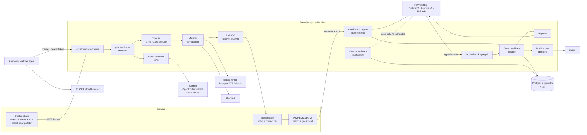
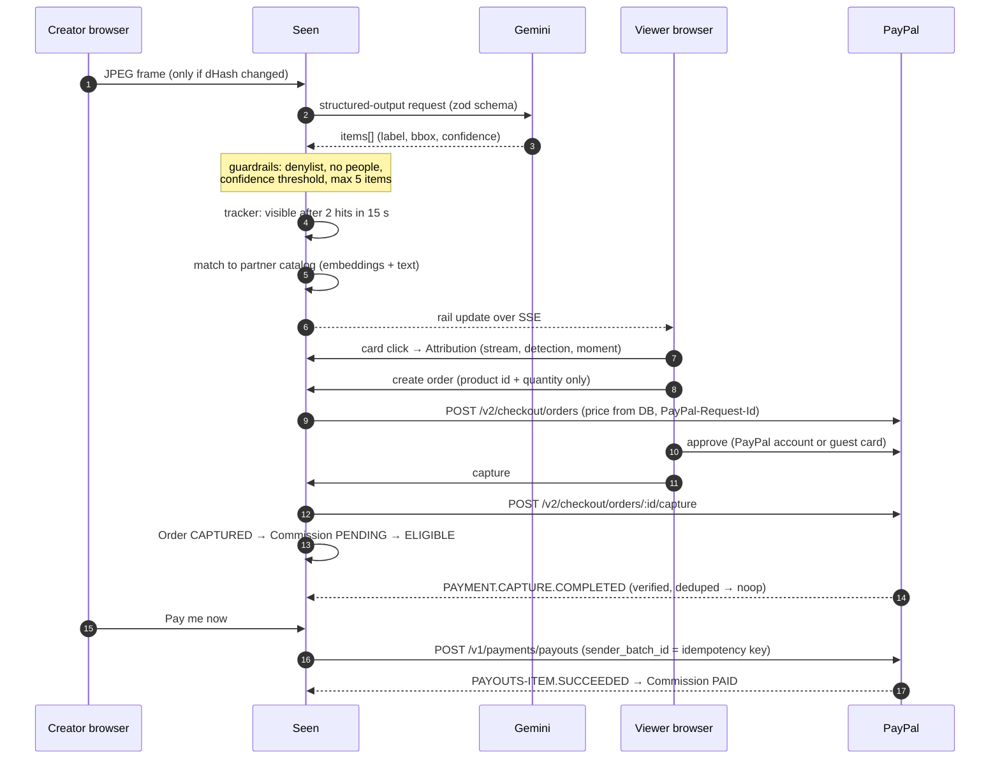
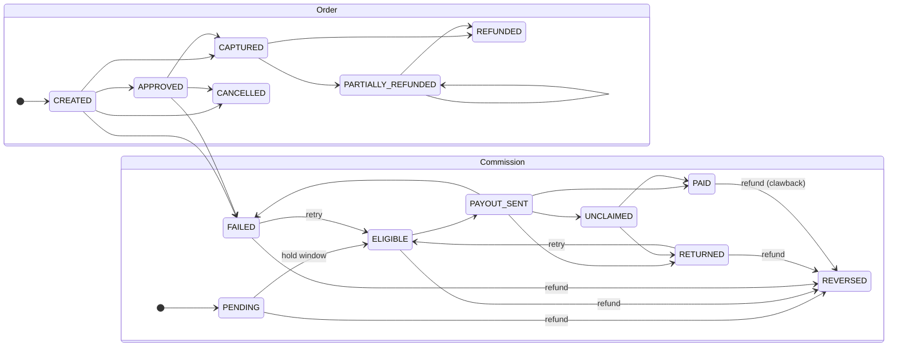

# Architecture

Seen is one Next.js 16 app (App Router) on a Postgres database with pgvector. An optional Astropods agent runs the capture loop for external stream URLs. Every sponsor service sits behind a flag in `lib/flags.ts`. When one is off, the core loop still runs on the fallback listed below.

## System

## Lifecycle of one sale

## Money rules

- **The AI never decides money.** It only says what's on screen. Prices, totals, currency, commission rates and payout amounts come from the database. They are computed server-side in integer minor units (`lib/money.ts`, with the currency exponents PayPal uses, e.g. JPY has 0 decimals).
- **One state machine per entity.** Orders (`lib/state/order.ts`) and commissions (`lib/state/commission.ts`) change only through `transition()`. It returns `applied`, `noop` or `rejected`, and only `applied` performs side effects. That is how the browser capture and the webhook for the same capture converge without double-counting.
- **Idempotency everywhere.**
  - Every PayPal POST carries a `PayPal-Request-Id`.
  - Payout batches use our own `sender_batch_id`, and items use the commission id.
  - Webhook events are stored by PayPal event id, so a replay is reported as `duplicate`.
- **Webhooks fail closed.** Each event is verified with `POST /v1/notifications/verify-webhook-signature`. Without `PAYPAL_WEBHOOK_ID`, every event is rejected.
- **Audit trail.** Every change writes an `AuditEvent` (source: ai, webhook, creator, viewer, system or kernel). The studio shows it as a timeline.

### Order and commission states

The exact allowed transitions are in `lib/state/*.ts` and covered by `lib/state/state.test.ts`.

## Vision pipeline

1. **Sample (browser).** The video is drawn to a canvas every `FRAME_INTERVAL_SEC`, at ≤768 px wide, as JPEG.
2. **Change filter (browser).** A 64-bit dHash is computed. The frame is sent only if its Hamming distance from the last sent frame exceeds `DHASH_MIN_DISTANCE`, or every `MAX_STALE_SECONDS` regardless.
3. **Cache (server).** With `DEMO_CACHE=true`, a frame close to a cached frame reuses the cached result, so it costs no quota.
4. **Budget (server).** `lib/budget.ts` `consume()` checks the per-provider RPM/RPD counters. At 80% of a limit, the studio shows a "free-tier saver mode" badge and the frame rate drops.
5. **Analyze.** The model order is Gemini, then its fallback models, then OpenRouter's free vision models, then "unavailable". Output is validated with zod, retried once with a fix-your-JSON message, and then guardrailed:
   - category denylist;
   - nothing about people;
   - text inside the frame is treated as data, never as instructions.
6. **Track.** Labels are embedded and clustered against active detections. A detection becomes visible after 2 hits in 15 s, or on the first sighting when both confidence and prominence are high (the fast lane). A hidden detection never comes back for that stream.
7. **Match.** The partner catalog is searched through `ProductSearch` (Elastic hybrid BM25 + kNN, or the Postgres FTS + pgvector fallback) and scored as "Exact" or "Similar". Channel3 adds open-web similar items and a price comparison.

## Live video

Seen doesn't relay video. When a viewer opens a live stream:
1. The viewer's browser posts a WebRTC offer to `/api/live/:slug/webrtc`.
2. The creator's studio polls `/api/streams/:id/webrtc`, answers with its screen share or video file, and posts the answer back.
3. The video then flows **browser to browser**. Free public STUN servers help the two browsers find each other (`WEBRTC_STUN_URLS`), and an optional TURN relay can be configured.

The handshake lives in memory for a few seconds (`lib/realtime/webrtc.ts`), like the rail's event bus. The creator's studio caps viewers (`WEBRTC_MAX_VIEWERS`), because each viewer is a separate upload from the creator's browser. If a direct connection fails, the viewer page shows the newest frame the studio already sent for AI analysis (`lib/realtime/snapshot.ts`). Peer-to-peer means the creator and viewers can see each other's IP addresses.

## Fallbacks

| Service | When it's off or down |
|---|---|
| Gemini | OpenRouter free models, then the demo cache, then "AI unavailable" (manual Force detection still works) |
| Elastic | Postgres full-text + pgvector, same interface |
| Channel3 | Partner cards still show; the "similar items" section shows unavailable |
| KERNEL | Upload and screen-share sources still work |
| Astropods | `WATCHER_RUNTIME=local` runs the same loop in-process |
| Zapier | In-app notification center (🔔), each item marked delivered or not |
| Bryntum | Built-in agenda list with the same events |
| PayPal webhooks | Browser capture plus payout status polling cover the core loop |
| Live video (WebRTC) | Viewers see the latest frame snapshot, refreshed every few seconds; with the flag off, the recorded video or a placeholder |

## Code map

| Path | What |
|---|---|
| `app/live/[creatorSlug]` | Viewer page |
| `app/studio/*` | Creator Studio: live, detections, earnings, schedule, settings, demo panel |
| `app/recap/[streamId]` | Shareable stream recap |
| `app/api/*` | Route handlers (see `postman/` for every endpoint) |
| `lib/paypal/` | Typed PayPal client: token cache, retries, idempotency |
| `lib/commerce/` | Checkout, capture, refunds, commissions, payouts, webhooks |
| `lib/state/` | Order and commission state machines |
| `lib/ai/`, `lib/vision/` | Providers, schema, guardrails, dHash, tracker, cache |
| `lib/search/`, `lib/matching/`, `lib/channel3/` | Product search and matching |
| `lib/assistant/` | Creator assistant (Gemini tools + PayPal Agent Toolkit, read-only) |
| `lib/shopper/`, `components/live/shopper-chat.tsx` | Viewer shopping agent: stream-scoped tools, buy-intent gate, no-AI fallback, per-viewer limit |
| `lib/kernel/`, `astropods/` | Stream-URL watcher |
| `lib/budget.ts`, `lib/flags.ts`, `lib/settings.ts` | Quota guard, feature flags, runtime overrides |
| `prisma/` | Schema, migrations, seed |
